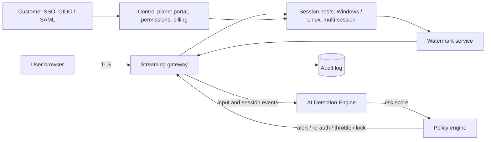

# QALA — Secure App Streaming That Stops AI Cloning

**Team:** CORE TETYM · **Base:** Baku, Azerbaijan · **Stage:** Pre-seed (concept and validation) · **Date:** 9 October 2026

> Figures marked *(assumption)* are planning estimates, not measured results. Market and competitor figures come from the public sources listed in section 18. Detection figures in section 8 come from the working prototype's own benchmark.

**Live prototype:** an open demo (demo app + working detector + re-runnable benchmark) and a product page are linked at the end of section 10.

---

## 1. Summary

QALA lets a software company run its application in the cloud and give users access through a browser link. Users see and control the app, but only encrypted pixels reach their device. The binary never leaves QALA's servers, so there is nothing to download, decompile or feed to an AI model.

On top of streaming, QALA adds an **AI Detection Engine** that spots automated agents trying to map and copy an app through its interface, and **forensic watermarks** that trace leaked screenshots back to a specific user session.

For end users, the same model removes the need for powerful hardware: a basic laptop or tablet can run heavy software because the computing happens on the server.

---

## 2. The problem

### 2.1 AI has made reverse engineering cheap
- Open-source LLM decompilers can turn binaries back into working code. LLM4Decompile-9B-v2 reached a 64.9% re-executability rate on its benchmark in 2024. [1]
- Through the Model Context Protocol (MCP), AI assistants can now drive professional reverse-engineering tools such as IDA Pro, Ghidra and Frida directly. [2]
- 2026 security guidance lists AI-accelerated attacks as a top threat: LLMs speed up reading decompiled code, undoing obfuscation and building convincing clones. [3]

### 2.2 Existing defences keep the code on the user's device
Obfuscation and runtime self-protection tools (Guardsquare, Digital.ai, DoveRunner) make analysis harder, but the protected binary still ships to every user. Guardsquare alone serves more than 850 companies, which shows vendors already pay to protect their code. [4] As AI gets better at reading obfuscated code, these tools buy time rather than closing the door.

### 2.3 Streaming exists, but nobody sells it as clone protection
App-streaming platforms (AWS, Microsoft, Citrix, Omnissa, Google Cameyo, GraphOn, Kasm, Dizzion) already keep code on servers. Their message is remote work, legacy apps and central IT management. None of them offers detection of AI-driven interface crawling or forensic leak tracing as a core product. [5–12]

### 2.4 Who feels the pain
- Independent software vendors (ISVs) selling desktop products: accounting, ERP, CAD and engineering, vertical industry tools.
- Companies with proprietary internal tools (pricing, trading, logistics) that contractors and partners must use.
- Software companies in markets with high piracy, which lose licence revenue to cracked copies.

---

## 3. Why now

1. **AI agents can now operate desktop software.** AWS extended WorkSpaces Applications so AI agents can use desktop apps, and Google lets Gemini interact with Windows apps hosted on Cameyo. [5][9] The same capability can be pointed at a competitor's product.
2. **Incumbent pricing is pushing buyers to look around.** Citrix customers faced renewal increases and a mandatory licensing migration in 2026, and Omnissa raised Horizon bundle prices from 4 May 2026. [7][8]
3. **Browsers are good enough.** Browser-first platforms already stream at 4K and 60 fps with no client install, so user experience no longer blocks adoption. [12]

---

## 4. The solution

### 4.1 How it works — Universal Cloud Sharing

| Step | Who | What happens |
|---|---|---|
| 1. Upload | Software company | Uploads its app (Windows or Linux). No code changes. |
| 2. Set permissions | Company admin | Chooses which folders, screens and features each role can access, and sets clipboard, file-transfer and printing rules. |
| 3. Share | Company | Sends a link. Users sign in with SSO and open the app in any modern browser. |
| 4. Protect | QALA | Runs the AI Detection Engine, watermarks every session and logs activity automatically. |

Core capabilities:
- **Any app, zero rewrites:** runs the existing build.
- **Any device, browser only:** Windows, macOS, Linux, ChromeOS and tablets.
- **Folder and feature permissions:** each user sees only what their role needs.
- **SSO, roles and audit log:** OpenID Connect and SAML, with per-session records.
- **Auto-scaling multi-session hosts:** many users per server to keep cost down.
- **Deployment choice:** QALA cloud, a Baku data centre, or the customer's own servers.

### 4.2 AI Detection Engine

Streaming removes the binary, but an agent can still try to copy an app by exploring its interface. QALA watches for that.

| Layer | Signals | Purpose |
|---|---|---|
| Behaviour analysis | Input timing, mouse-path shape, speed of discovering new screens, breadth-first menu exploration | Separate human work from systematic crawling |
| Agent fingerprinting | Browser-automation flags, scripted input patterns, headless or virtual-display traits | Identify automation tools and computer-use agents |
| Honeypot screens | Hidden decoy menus and features that normal users never open | A touch is a high-confidence crawler signal |
| Forensic watermark | Invisible per-session marks in the video stream | Trace any leaked screenshot or recording to a user and time |

**Graduated response instead of a blunt block:** risk score → admin alert → step-up re-authentication → session throttling → session lock. Admins can allow-list approved automation such as RPA bots and accessibility tools to avoid false positives.

**Two honest points about the layers:**
- **Honeypots are drawn by the QALA client, not added to the vendor's binary.** The vendor's app is unchanged. QALA's streaming client overlays the decoy menu items and screens into the session, so only something enumerating the DOM or the session tree — never a human looking at the rendered pixels — reaches them.
- **Fingerprinting is not enough on its own.** A modern computer-use agent can drive an ordinary browser with real OS-level input and no automation flags. So the engine leans on *behaviour* (coverage speed, forward-only sweeps, timing) and *honeypots*, with fingerprinting as a supporting signal — not as the primary defence.

### 4.3 Benefits for end users
- **No costly hardware:** heavy CAD or GPU software runs on a basic laptop, because the server does the computing.
- **Anywhere, anytime:** open a link from the office, at home or on the road.
- **Any device, any OS:** no "Windows only" barrier.
- **Zero installs or updates:** the company updates once and everyone gets the new version instantly.

### 4.4 Use cases
1. ISVs protecting desktop products from cloning and piracy.
2. **Secure trials and demos:** prospects try the full product without receiving the installer.
3. Contractor and partner access to internal tools without installing anything.
4. Education and labs: students use professional software on low-cost devices.
5. Controlled AI-agent access: approved agents use an app under policy; unapproved ones are detected.

### 4.5 Architecture (planned)

- **Streaming gateway:** built on Apache Guacamole, a clientless HTML5 gateway for RDP, VNC and SSH, released under the Apache License 2.0. [16] A WebRTC transport is planned for lower latency.
- **Session hosts:** containerised or VM-based and auto-scaled; GPU hosts for Enterprise.
- **Detection pipeline:** event stream → feature extraction → anomaly and classification models → risk score.
- **Hosting:** major public clouds first, then a Baku data centre and customer on-premises installs.

Why not Kasm as the base: its free Community Edition is licensed for testing, non-profit and non-commercial use and is limited to 5 concurrent sessions. [11] A commercial product needs a paid licence or an Apache-licensed base.

### 4.6 Honest limits
- QALA cannot stop someone from filming a screen. An **invisible** watermark that survives a phone camera is hard, so until it is tested we claim traceability only for screenshots and recordings, and we add a **faint visible session ID** to deter camera filming. Full camera-robust marking is a research item.
- Behavioural cloning can be slowed, detected and traced, not made impossible. The prototype benchmark (section 10) shows the real limit: a patient low-and-slow agent largely evades the per-session detector.
- An internet connection is required; offline use is not supported.
- Latency-critical apps such as real-time games are not the first target.
- Pixel streaming can hurt accessibility; screen-reader support inside sessions is on the roadmap.

---

## 5. Market

| Adjacent market | 2025 size | Forecast | CAGR | Source |
|---|---|---|---|---|
| Virtual desktop infrastructure (VDI) | $8.92B | $23.43B by 2032 | 14.8% | Coherent Market Insights [13] |
| Desktop as a Service (DaaS) | $7.89B | $14.09B by 2030 | 12.3% | Knowledge Sourcing Intelligence [14] |
| In-app protection | $2.1B | $8.9B by 2035 | 17.7% | Custom Market Insights [15] |

VDI and DaaS reports overlap in definition, so they are not added together.

- **TAM (spend QALA competes for): about $11B in 2025**, combining VDI ($8.9B) and in-app protection ($2.1B). QALA sits where the two meet: delivery infrastructure that also protects the app.
- **SAM:** ISVs with desktop products and companies with proprietary internal tools in Azerbaijan, the South Caucasus, Central Asia and Türkiye, then global ISVs through cloud marketplaces. Sized bottom-up as *qualifying companies × average concurrent users × price × 12*; the company count will be measured during Phase 1 customer discovery.
- **SOM (3-year target):** $6.48M ARR from 120 customers *(assumption)*, about 0.06% of TAM.

---

## 6. Competition

| Product | Main focus | List price (licence) | Browser, no client | Anti-clone features |
|---|---|---|---|---|
| GraphOn GO-Global | Windows ISVs | From $4.20 per concurrent user / month [10] | Yes | App lock-down only |
| Azure Virtual Desktop | Microsoft customers | $5.50 per external user / month + Azure infrastructure [6] | Partial | No |
| Kasm Workspaces | Security and DevOps teams | Free CE (non-commercial), Starter $10 per user / month [11] | Yes | DLP only |
| Cameyo by Google | Google / ChromeOS customers | $132 per user / year [9] | Yes | No |
| Citrix DaaS | Large enterprises | $10–23 per user / month list; $25–40 typical in practice [7] | Client recommended | No |
| Amazon WorkSpaces Applications | ISVs, training, demos | Hourly instance pricing [5] | Yes | No |
| Omnissa Horizon | Large enterprises, VDI | Quote-based [8] | Partial | No |
| Dizzion Frame | Browser-first DaaS | Quote-based [12] | Yes | No |
| Guardsquare (indirect) | Mobile code protection | Quote-based [4] | Not applicable: code stays on device | Yes (obfuscation, RASP) |

**Positioning:** incumbents are strong on delivery but silent on cloning; code-protection vendors are strong on protection but still ship the binary. QALA combines both. The closest rival on price and audience is GO-Global, which has no detection layer.

---

## 7. Business model

### 7.1 Pricing (per concurrent user, per month)

| Plan | Price | Includes |
|---|---|---|
| Starter | $8 | Up to 50 users, browser streaming, folder permissions, SSO, standard watermark, hosting |
| Pro | $18 | Starter + AI Detection Engine, forensic watermark, feature-level permissions, 90-day audit, 99.9% SLA |
| Enterprise | From $28 | Pro + on-prem or Baku data centre, GPU apps, unlimited audit, SOC 2 reports, dedicated manager |

QALA is priced above pure-streaming tools such as GO-Global because it sells protection as well as delivery, and below what enterprises often pay for Citrix in practice.

### 7.2 Unit economics *(assumption, to be measured in pilots)*
- Infrastructure cost: about $5–6 per concurrent user per month on multi-session hosts (compute, storage, bandwidth).
- Pro plan gross margin before support: ($18 − $6) / $18 ≈ 67%. Target blended gross margin: about 65% by year 3.
- GPU workloads are priced separately in Enterprise to protect margin.

**Windows licensing — handled explicitly.** Microsoft bills Azure Virtual Desktop external access per external user who connects at least once a month (~$5.50), and the RDS route is per user too, while QALA charges per *concurrent* user. If that licence is not inside the $5–6 figure, a Windows Starter seat can lose money and Pro's Windows margin drops from ~67% toward ~36%. So: the $5–6 cost covers **Linux and internal web apps**; **Windows seats carry the Microsoft licence as a pass-through quoted per deployment**, confirmed at proposal, not absorbed into list price. Many target ISVs ship Linux or web apps, where the list margin holds.

---

## 8. Customer value — framed as break-even, not a headline ROI

We don't know any customer's real clone-risk percentage, so instead of a headline "446% ROI" built on a guessed 10%, we quote the **threshold a customer needs to clear for QALA to pay for itself**. That is honest and still compelling.

Example: an ISV with $5M annual revenue and 500 concurrent users on the Pro plan. Pro costs **500 × $18 × 12 = $108,000 / year.**

- **Break-even on cloning alone:** $108,000 / $5,000,000 = **2.2% of revenue**. If QALA prevents cloning losses worth more than 2.2% of revenue, it has paid for itself.
- **Break-even counting operational savings:** installation/support time saved (~$50k) and maintaining one build instead of many (~$40k) cover ~$90k, so the cloning loss QALA needs to prevent drops to about **$18,000 — roughly 0.4% of revenue.**

Every pilot replaces the 2.2% threshold with the customer's own exposure, measured from their incident history and the clone-risk assessment we run for free. For reference, a 10% exposure would imply ~$500k protected and a ~446% ROI — but that number is the customer's to validate, not ours to claim.

---

## 9. Go-to-market

1. **Phase 1, Baku (months 0–6):** founder-led sales to local ISVs; 3 discounted pilots in exchange for case studies; a public "attack vs. defence" demo that shows an AI agent cloning an unprotected app and failing on QALA.
2. **Phase 2, region (months 6–18):** partners and system integrators in Georgia, Kazakhstan, Uzbekistan and Türkiye; a regional data centre as a data-residency advantage.
3. **Phase 3, global (2028):** AWS and Azure Marketplace listings and a self-serve Starter plan for small ISVs.

Lead magnets: a secure trial mode that ISVs can offer their own prospects, and a free clone-risk assessment of the customer's app.

---

## 10. Current status and validation plan

**Done:** competitor and pricing analysis, solution design, pricing model, pitch deck, **and a working detection prototype with a measured benchmark (10.1).**
**Not yet done:** customer interviews, pilots, the production streaming layer.

### 10.1 Prototype and measured results

The prototype is a browser-based detection console: a demo app, the live detector, an attack lab, and a benchmark that runs in the page (links below). The detector is a transparent weighted logistic classifier over seven behavioural features (action speed, timing regularity, coverage speed, forward-sweep streak, pointer movement, backtracking, dwell) plus a honeypot rule — every weight and per-feature contribution is shown live.

**What the detector needs in production:** the session event stream QALA already has from the streaming gateway — navigation and action events with timestamps, pointer-movement presence, and which screens/features were touched. No app instrumentation and no content capture; features are computed from interaction metadata only.

**Benchmark (100 sessions per type, deterministic seed; re-runnable in the demo):**

| Defence | Naïve crawler | Jittered bot | Human-mimicking agent | Low-and-slow agent | Real users wrongly flagged |
|---|---|---|---|---|---|
| No detection | 0% | 0% | 0% | 0% | 0% |
| Simple rate-limit rule | 100% | 100% | ~43% | ~1% | **~18%** |
| **QALA detector** | **100%** | **100%** | **~67%** | **~3%** | **~1%** |
| **QALA v2 (trained, held-out seed)** | **100%** | **100%** | **~73%** | **~38%** | **~1%** |

**Headline:** in the seeded run (seed 777, the one the demo opens with), QALA catches human-mimicking agents ~1.5× as often as a rate-limit rule (67% vs 43%) while flagging far fewer real users (1% vs 18%). Averaged over 30 random seeds: 63% vs 40% caught, and 2.4% vs 17% of real users flagged, about 7× fewer. Naïve and jittered crawlers are caught every time.

**Trained model (v2):** a logistic-regression model trained on 10,612 labelled prefixes from 1,000 simulated sessions (seed 4242, class-balanced, L2), averaged with the calibrated v1. Its threshold was checked on validation seed 9191, and seed 777 is held out from training. Over 30 random seeds, v2 catches 69% of human-mimic agents (v1: 63%) and 29% of low-and-slow agents (v1: 4%), while flagging 3.5% of real users (v1: 2.4%, rate limit: 17%). Caveat: v2 leans on the pointer-movement signal, which a real agent can fake, so it must be retrained on pilot data. `train_v2.js` reproduces the weights, and 16 automated tests check every number above.

**Streaming preview:** the demo now includes a working miniature of the delivery layer. A Web Worker plays the QALA host: it runs the app, renders each screen to pixels, burns in the session watermark and sends JPEG frames (about 30 KB each). The page only displays frames and sends back click coordinates, and the gateway forwards those inputs to the detector. In production the host is an Apache Guacamole session on QALA servers.

**Honest failures (shown in the demo):**
1. **Low-and-slow agents** that pace themselves and copy human backtracking are caught only ~3% of the time — they map the app slowly. Mitigation: cross-session aggregation (the same account mapping an app over days) and honeypots.
2. **Late locks:** when a fast mimic *is* caught, it has often already mapped ~80% of the screens. The lock limits further damage but isn't instant.
3. **Power-user false flags:** ~1% of fast, thorough real users get a step-up prompt. Tunable per app.

| Next 90 days | Success metric |
|---|---|
| Customer discovery | 20 interviews with ISVs and IT leads |
| Demand proof | 3 signed letters of intent |
| Technical proof | MVP on Apache Guacamole: upload, permissions, browser streaming, SSO |
| Detection proof | Prototype detects a scripted computer-use agent on a demo app; false-positive rate measured on real human sessions |
| Cost proof | Measured infrastructure cost per concurrent user |

**Pivot rule:** if fewer than 3 of the 20 interviewed ISVs rank AI cloning or piracy among their top 3 problems, QALA repositions around secure trials and legacy-app delivery.

**Prototype links** (set sharing to public before submitting so judges can open them):
- Live detection demo: https://claude.ai/artifact/8zZLCSXyKo9uDJRyPup5AJ
- Product landing page: https://claude.ai/artifact/7KDYP3GnHQGQpdSeqiGgMp
- Source: the demo page is a single self-contained HTML file (shared with this brief).

---

## 11. Roadmap

| Phase | Timing | Deliverables | Gate to next phase |
|---|---|---|---|
| 01 MVP | By Q1 2027 | Upload portal, folder permissions, browser streaming, SSO | 3 pilot customers |
| 02 Anti-clone v1 | Q2 2027 | Invisible watermark, bot and agent detection, audit log | 10 paying customers |
| 03 Enterprise | Q3–Q4 2027 | On-prem install, Baku data centre, GPU apps, SOC 2 preparation | First enterprise contract |
| 04 Scale | 2028 | AWS / Azure Marketplace, AI-agent access policies, new regions | 120 customers |

---

## 12. Financial projection *(assumption)*

| | Year 1 | Year 2 | Year 3 |
|---|---|---|---|
| Paying customers | 10 | 40 | 120 |
| Average concurrent users per customer | 150 | 200 | 250 |
| Average price per user per month | $16 | $17 | $18 |
| Annual recurring revenue | $288k | $1.63M | $6.48M |

Target gross margin is about 65% by year 3; margins will be lower while host density is still small.

---

## 13. Team — CORE TETYM

*[To complete: name, role, relevant experience and time commitment of each member.]*

Roles the plan needs:
- CEO / business lead: customer discovery, sales, fundraising
- CTO: streaming infrastructure, cloud and security
- ML and security engineer: AI Detection Engine and watermarking
- Advisor: enterprise sales or cybersecurity

---

## 14. The ask

*[To complete: amount and investment instrument.]*

Proposed use of funds: 50% engineering, 25% infrastructure and security certification, 25% sales and pilots. The round should fund the company to the Phase 2 gate: 10 paying customers.

---

## 15. Risks and mitigations

| Risk | Impact | Mitigation |
|---|---|---|
| Customers don't see AI cloning as urgent | High | Validate in 20 interviews; lead with piracy and secure trials, which are proven pains |
| Large players add anti-clone features | High | Move fast on detection, focus on the region, partner through marketplaces; acquisition is a realistic exit (Google bought Cameyo in 2024) [9] |
| Customers distrust uploading their app | High | On-prem option, encryption, session isolation, SOC 2 and ISO 27001 roadmap, audit logs |
| False positives block real users | Medium | Graduated responses, allow-lists for RPA and accessibility tools, human review |
| Infrastructure cost erodes margin | Medium | Multi-session density, auto-scaling, separate GPU pricing, real cost data from pilots |
| Latency and connectivity | Medium | Regional data centres, WebRTC transport, business apps first |
| Accessibility gaps in pixel streaming | Medium | In-session screen-reader support and keyboard navigation on the roadmap |
| Open-source licensing | Low | Apache-licensed base (Guacamole); no non-commercial components |

---

## 16. Impact

- Protects the intellectual property of local and regional software companies.
- Lets legacy desktop software move to a subscription model without a rewrite.
- Lowers hardware spending and e-waste, because heavy software runs on cheap devices.
- Widens access for students and small firms that cannot afford workstations.
- Keeps data in the country through a local data centre.

---

## 17. Anticipated questions

**Why can't AWS or Microsoft simply add this?**
They can add features, but their focus is general-purpose VDI at global scale. QALA's edge is speed on detection, a regional presence and an ISV-first product. If they move in, QALA becomes an acquisition candidate, as Cameyo did for Google.

**Does streaming fully stop cloning?**
It stops code theft, because the binary never leaves the server. Copying through the interface is slowed, detected and traced, not eliminated.

**What if a user films the screen?**
That cannot be prevented. The forensic watermark identifies the session, which deters leaks and supports enforcement.

**How do you avoid flagging power users or accessibility tools?**
Risk scoring rather than single rules, allow-lists, and step-up verification before any block.

**Is monitoring user behaviour acceptable?**
QALA enforces the software owner's own access policy. Monitoring will be disclosed in the terms of use and limited to security telemetry, with a legal review in each market before launch.

**Why not rewrite the app as a web app?**
A rewrite takes years and large budgets. QALA delivers the existing build in weeks.

**What about apps that need USB devices or local printers?**
Printing and file transfer work through the browser. Specialised USB hardware is out of scope for the MVP.

**How do you protect customers' apps on your servers?**
Isolated sessions, encryption in transit and at rest, least-privilege staff access, audit logs, a SOC 2 roadmap, and on-prem deployment for the most sensitive customers.

**What happens to customers if QALA fails?**
Customers keep their own application. On-prem deployments keep running, and exportable configuration avoids lock-in.

**Why start in Azerbaijan?**
It is the home market for fast feedback and pilots. Growth comes through regional partners and cloud marketplaces.

---

## 18. Sources

1. LLM4Decompile (re-executability 0.6494, 2024): https://awesome.ecosyste.ms/projects/github.com%2Falbertan017%2Fllm4decompile
2. awesome-ai-reverse, MCP-driven reverse-engineering tools: https://www.sourcepulse.org/projects/29389196
3. Mobile App Security in 2026 (Agentpedia): https://agentpedia.codes/blog/mobile-app-security-2026
4. Guardsquare customer report (850+ customers): https://www.guardsquare.com/reports/apac-religious-lifestyle-app-prevents-attack-with-dexguard
5. Amazon WorkSpaces Applications: https://aws.amazon.com/appstream2/ · rename from AppStream 2.0: https://dev.classmethod.jp/articles/amazon-appstream2-rename-to-amazon-workspaces-applications/
6. Azure Virtual Desktop per-user pricing: https://onmsft.com/?p=42010
7. Citrix price increases in 2026 (Nerdio): https://getnerdio.com/blog/citrix-price-increase/ · Citrix DaaS list prices (Capterra UK): https://www.capterra.co.uk/software/116275/xendesktop
8. Omnissa Horizon price adjustments: https://www.schneider.im/lu/omnissa-horizon-price-adjustments-new-omnissa-licenses/
9. Cameyo by Google launch (Computerworld): https://www.computerworld.com/article/4088825/cameyo-by-google-launches-with-chrome-enterprise-integration-gemini-ai-support.html
10. GO-Global pricing: https://us.fitgap.com/products/go-global · https://www.graphon.com/go-global
11. Kasm Workspaces Community Edition terms (AWS Marketplace): https://aws.amazon.com/marketplace/pp/prodview-4qizt3gs5ett4 · Kasm pricing (GetApp): https://www.getapp.co.uk/software/2044879/kasm
12. Dizzion Frame: https://try.dizzion.com
13. VDI market, Coherent Market Insights (July 2025): https://www.globenewswire.com/news-release/2025/07/11/3114087/0/en/Virtual-Desktop-Infrastructure-VDI-Market-Poised-for-Growth-Expected-to-Hit-USD-23-43-Billion-by-2032-Coherent-Market-Insights.html
14. DaaS market, Knowledge Sourcing Intelligence: https://www.gii.tw/report/ksi1878413-desktop-service-market-forecasts-from.html
15. In-app protection market, Custom Market Insights: https://www.custommarketinsights.com/press-releases/in-app-protection-market-size/
16. Apache Guacamole: https://guacamole.apache.org/
